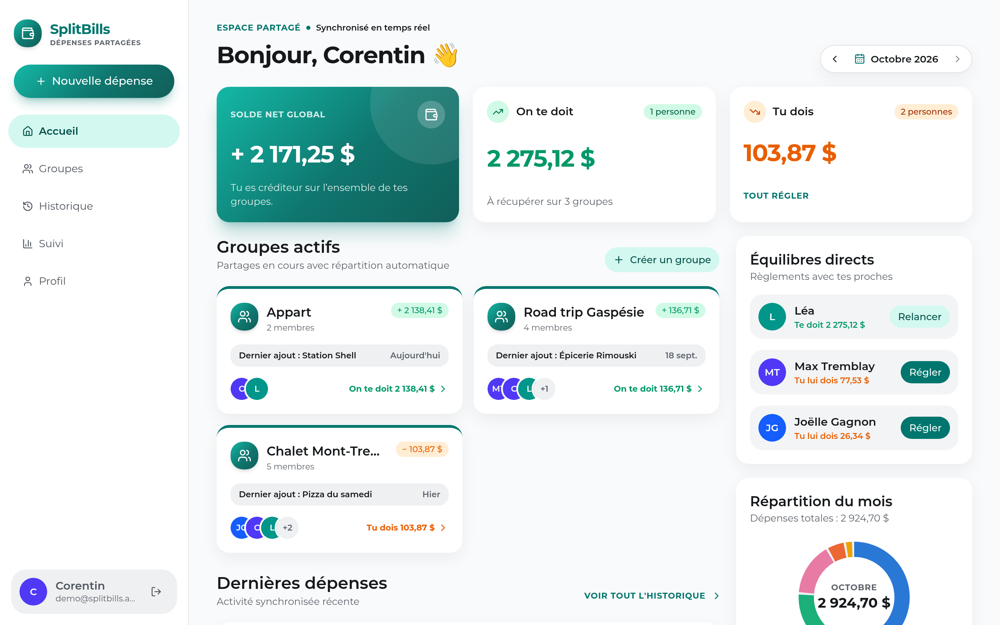
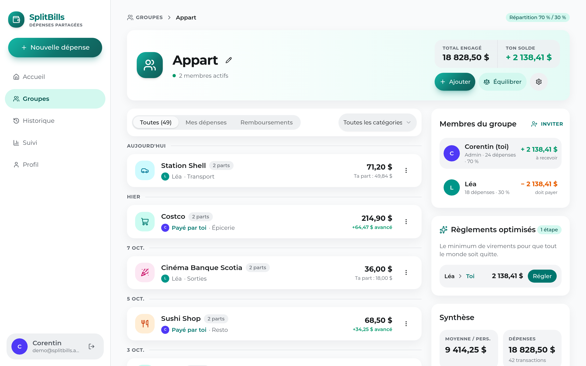
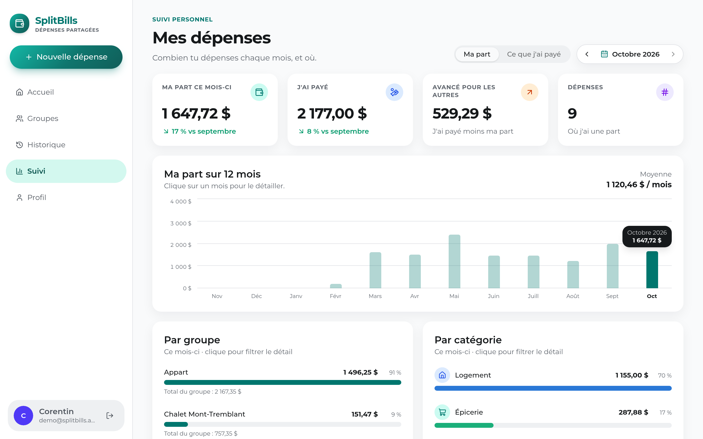
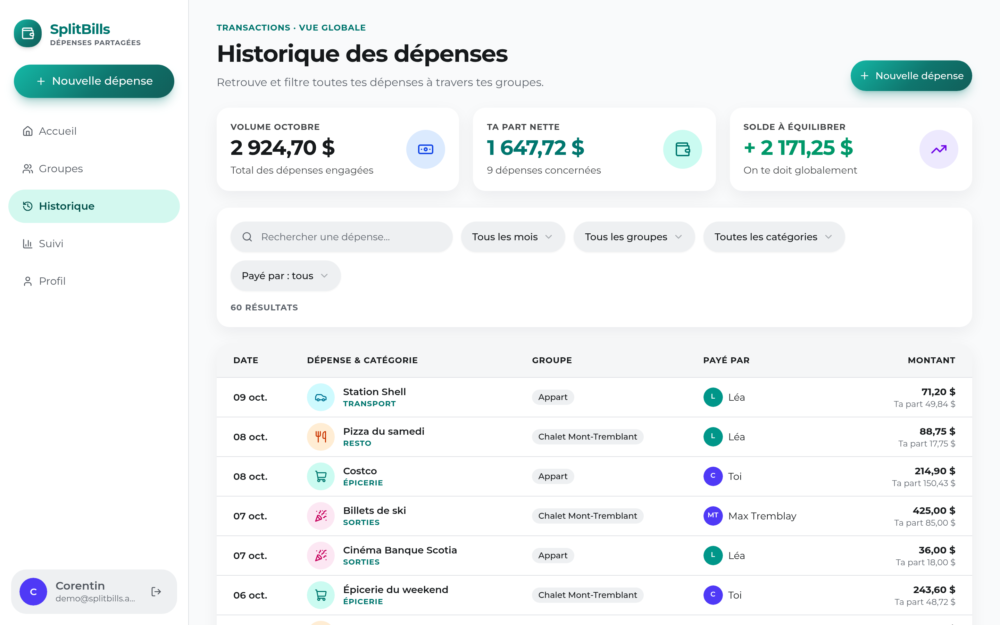
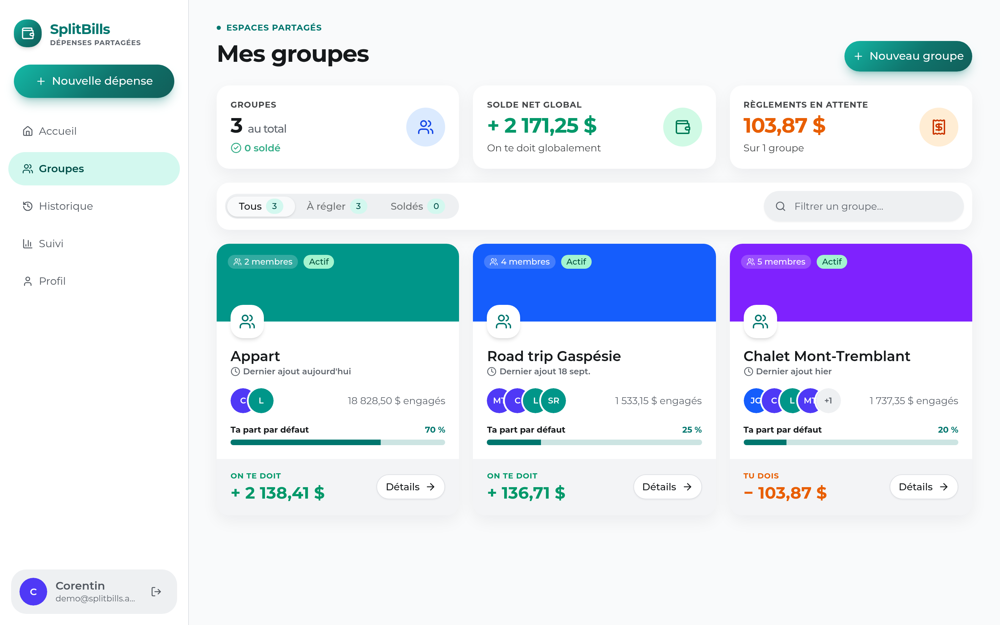
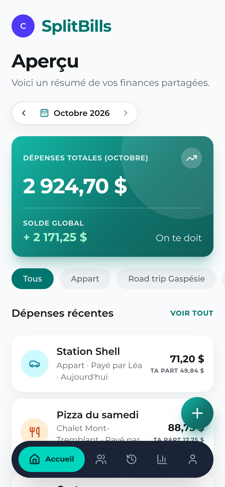
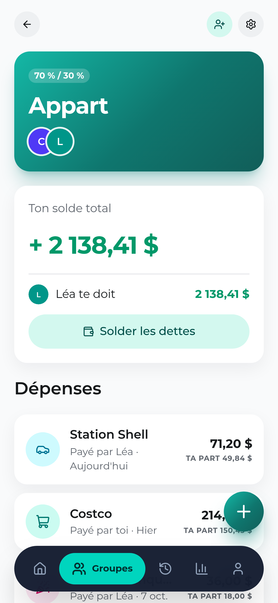
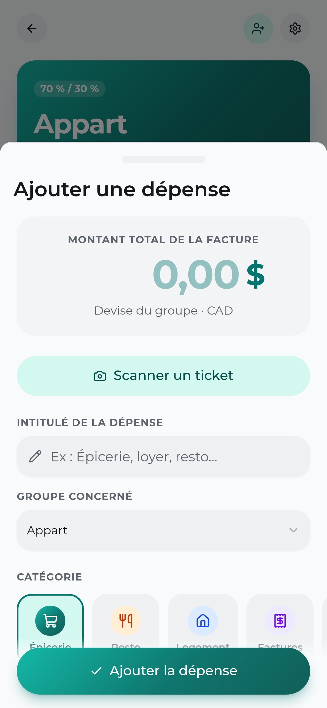
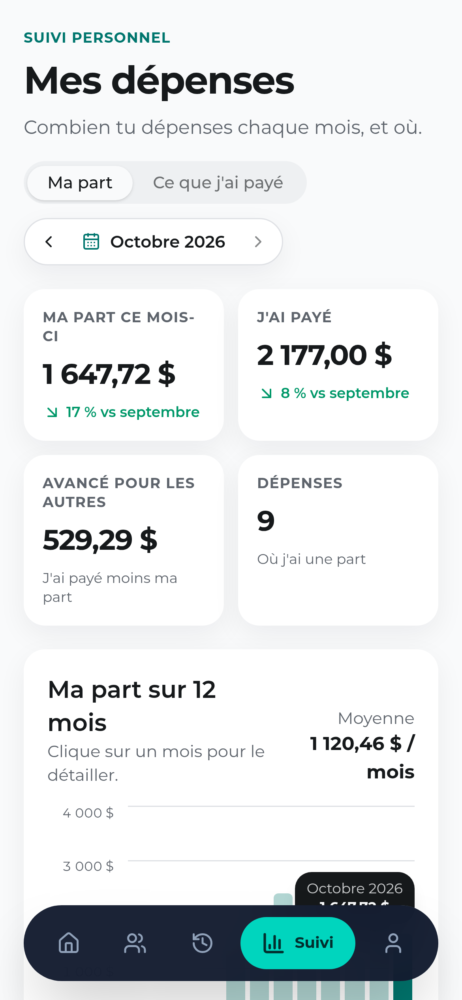

# SplitBills

Installable web app (PWA) for splitting expenses in proportion to income (e.g. 70 / 30).
React + Vite + Firebase (Auth, Firestore). Receipts are scanned on-device with Tesseract.js, and the flattened photo is kept with the expense (as a small JPEG in its own Firestore document, so no Storage bucket is needed).

## Screenshots



| Group | Insights |
|---|---|
|  |  |

| History | Groups |
|---|---|
|  |  |

### Mobile

| Home | Group | New expense | Insights |
|---|---|---|---|
|  |  |  |  |

## Getting started

1. Firebase console: create a project, then a **Web app**, and copy its config.
2. Enable **Authentication** → *Email/Password* and *Google*.
3. Create a **Firestore** database (production mode).
4. `cp .env.example .env` and fill in the values.
5. `npm install && npm run dev`

## Deploy (Firebase Hosting)

```sh
npx firebase-tools login
npm run build
npx firebase-tools deploy --project <project>   # hosting + Firestore rules
```

Add the hosting domain under *Authentication → Settings → Authorized domains* if it isn't there.

## Notifications

Group members get a notification when someone adds an expense or a payment to the group.
Sending goes through a Cloudflare Worker (`worker/`) on the free plan: the Firebase project stays on Spark and nothing can be billed.
After each new entry, the app calls the worker with the user's Firebase ID token; the worker checks that this user just created the entry, then sends through Firebase Cloud Messaging.

1. *Project settings → Cloud Messaging → Web Push certificates*: generate a key pair and put it in `VITE_FIREBASE_VAPID_KEY`.
2. *Project settings → Service accounts*: *Generate new private key* (a JSON file, keep it out of the repo).
3. Deploy the worker:
   ```sh
   cd worker && npm install
   npx wrangler login
   npx wrangler secret put FIREBASE_SERVICE_ACCOUNT < path/to/key.json
   npm run deploy
   ```
4. Put the printed URL in `VITE_NOTIFY_URL`, then rebuild and redeploy hosting.
5. On the phone: *Profil → Notifications*. On iPhone, the app must be added to the home screen first (iOS 16.4+).

Notifications only work with the production build (not with `npm run dev`, which has no service worker).

- `node scripts/send-test-push.mjs <project> <google-account>` sends a sample notification to every registered device.
- `node scripts/simulate-expense.mjs <groupId>` has a throwaway member add an expense, end to end; `--cleanup` removes it.

## Install on a phone

Open the deployed URL, then:
- **iPhone (Safari)**: Share → *Add to Home Screen*
- **Android (Chrome)**: ⋮ menu → *Install app*

## Data model

- `groups/{id}`: `name`, `currency`, `memberIds[]`, `members{uid: {name, share}}`
- `groups/{id}/expenses/{id}`: an expense (`kind: 'expense'`, with a copy of the `shares`) or a payment (`kind: 'payment'`)
- `users/{uid}/pushTokens/{token}`: one document per device with notifications turned on

The invite link is `/join/{groupId}`: the group id acts as the secret.

## Scripts

- `npm run dev` — local server
- `npm run dev:host` / `npm run demo:host` — same, reachable from a phone through a QR code
- `npm run demo` — the app with in-memory sample data, no Firebase (nothing is saved)
- `npm test` — tests (balances, receipt parsing)
- `npm run build` — production build
